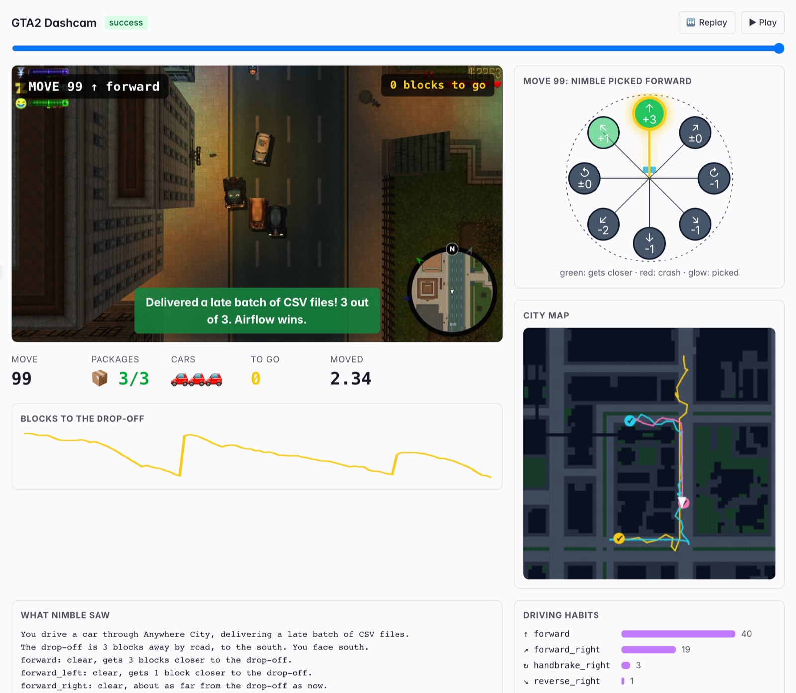
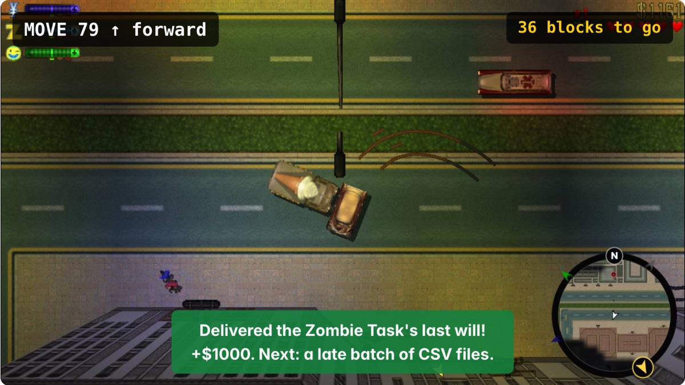
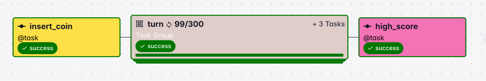
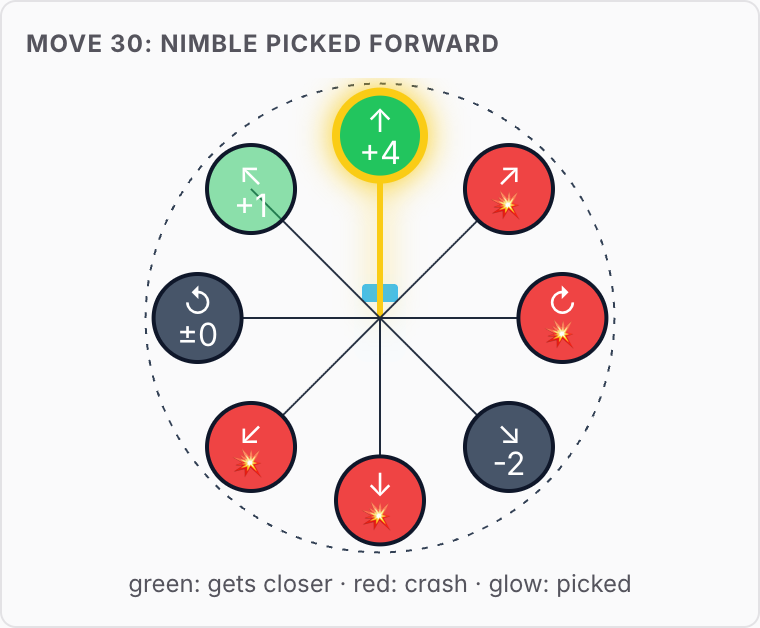
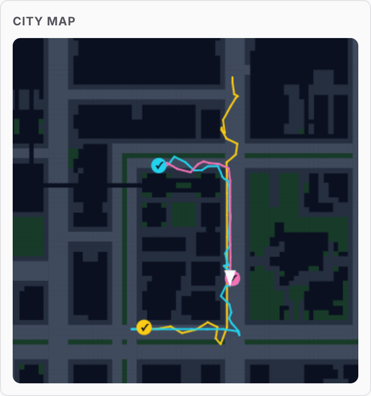
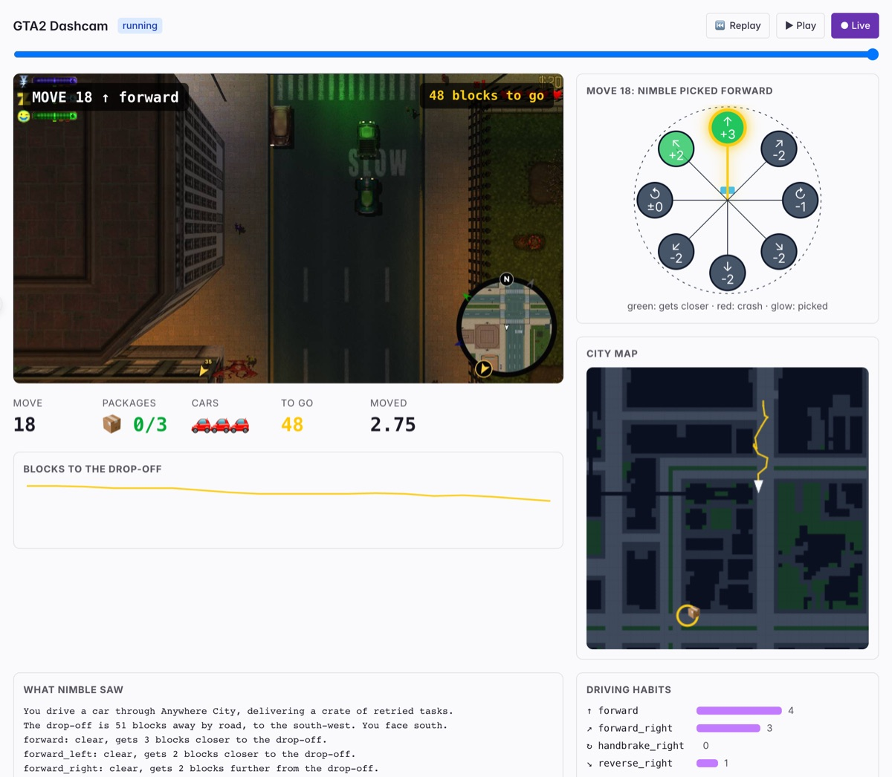

<h1 align="center">🚕 Airflow plays GTA2</h1>

<p align="center">
  <a href="https://airflow.apache.org"></a>
  
  
  
  <a href="https://ollama.com"></a>
  <br>
  
  
  
  
  
  
</p>

<p align="center">
  <b>An Apache Airflow 3.4 Dag that plays Grand Theft Auto 2.</b><br>
  Every move of the car is one iteration of a task loop. A small local decision model picks the move,<br>
  and a plugin shows what happened, live, in the Airflow UI.
</p>

<p align="center">
  
  <br>
  <sub>The GTA2 Dashcam tab after a won run: 3 of 3 packages delivered in 99 moves, no cars lost.</sub>
</p>

This demo shows the capabilities of the following Airflow features:

- **Task loops** (`.loop(...)` with a `LoopDecision` gate): one game move per iteration, with the game state handed from one iteration to the next.
- **Common AI `@task.llm`** with a Pydantic `output_type`: the model can only answer with one of eight moves.
- **Airflow UI plugins** (`react_apps` with `destination: "dag_run"`): a "GTA2 Dashcam" tab on every run, live and as a replay.

## The delivery mission

GTA2 has its own missions (phone booths, gang jobs). This project does not use them. It plays a custom delivery mission instead, which the bridge (see below) sets up and keeps score of from the outside:

1. The game starts normally ("start play in area 1", Downtown). The bridge then teleports the player to the district's longest straight road.
2. **Get a car:** the bridge spawns a car next to the player through the browser port's developer API. The player gets in with the game's own Enter key and animation, so there's no actual car theft.
3. **Deliver three packages:**
   - Each drop-off is a random road block 35 to 70 blocks away by road. The `seed` Dag param picks which one.
   - It shows as a waypoint on the radar. That marker belongs to the browser port's map overlay, which isn't part of the original game.
   - The package names ("the on-call pager", "a USB stick labelled 'prod_dump_final_v2'", ...) are just flavor text.
4. **Delivered:** when the car is within 2.5 blocks of the drop-off by road, the bridge counts the delivery and pays +$1000 into the game's cash counter. Then it sets the next drop-off.
5. **Cars:** if the player ends up out of the car or wasted, that car is lost and the bridge spawns a new one. After three lost cars the run ends.
6. **Time:** the Dag allows at most 300 moves.

<p align="center">
  
  <br>
  <sub>Move 79: delivery number two. The ice cream truck was not part of the plan.</sub>
</p>

**Ending conditions:**

| Outcome | When |
|---|---|
| Won | 3 packages delivered |
| Lost | 3 cars lost |
| Out of time | 300 moves |

## How it works

<p align="center">
  
  <br>
  <sub>The Dag in the Graph view: the <code>turn</code> group looped 99 of at most 300 times.</sub>
</p>

**One move:**

1. **`decide`:** a `@task.llm` gets a short text from the previous iteration. The text names the drop-off, says which way the car faces, and says what each of the eight moves would do. The model answers with a `Drive` object: one of `forward`, `forward_left`, `forward_right`, `reverse`, `reverse_left`, `reverse_right`, `handbrake_left` or `handbrake_right`.
2. **`drive`:** posts the move to the bridge. The bridge unpauses the game, holds the keys for that move for 700 ms of game time, pauses again, saves a screenshot and returns the new state.
3. **`game_over`:** the loop gate. It returns `LoopDecision(stop=..., reason=...)`.

**Where the text comes from:**

- The bridge reads GTA2's map file (`wil.gmp`) into a 256 × 256 street-level grid of road, pavement, field and blocked.
- It computes road distances to the drop-off with Dijkstra and simulates each move as an arc over the grid.
- For example:
  ```
  The drop-off is 27 blocks away by road, to the east. You face east.
  forward: clear, gets 5 blocks closer to the drop-off.
  forward_right: DANGER, crashes into a wall after 2.5 blocks, gets 2 blocks further from the drop-off.
  ```
- The map doesn't show posts or parked cars. So a move that just failed to move the car counts as DANGER until the car moves again.

| Piece | Path | Notes |
|---|---|---|
| GTA2 in the browser | `site/` | The pre-built [M1sterMo/gta2](https://github.com/M1sterMo/gta2): the [`gta2_re`](https://github.com/CriminalRETeam/gta2_re) decompilation compiled to WebAssembly. One line in `site/gamefiles.js` is changed to load the installer from the bridge instead of the Internet Archive. |
| Bridge | `bridge/bridge.py` | FastAPI and Playwright on the host. It runs your installed Chrome with a persistent profile and drives the game through the port's developer API (`?devdata`). It also runs the mission. |
| Map reader | `bridge/gmp.py` | Reads the DMAP chunk of a GTA2 `.gmp` file. |
| Lookahead | `bridge/driver.py` | Road distances, move simulation and the text for the model. |
| Dag | `airflow/dags/airflow_plays_gta2.py` | `insert_coin` → `turn` loop (`decide`, `drive`, `game_over`) → `high_score` |
| Bridge client | `airflow/include/gta2/bridge.py` | Standard library HTTP client |
| GTA2 Dashcam plugin | `airflow/plugins/` | React app on every run of a Dag tagged `gta2` |
| Terminal feed | `scripts/feed.py` | One line per move, read from the run's XComs |
| Bridge check | `scripts/play_test.py` | A scripted player drives 60 moves, without Airflow |

### The GTA2 Dashcam tab

Open a run, then the **GTA2 Dashcam** tab.

<table>
  <tr>
    <td align="center" width="50%">
      <br>
      <sub>Move 30: five moves would crash (💥). The model picks the glowing <code>forward</code>, which gets 4 blocks closer.</sub>
    </td>
    <td align="center" width="50%">
      <br>
      <sub>The city map: one trail color per delivery, ✓ for each drop-off.</sub>
    </td>
  </tr>
</table>

- **Dashcam:** the game screenshot of each move, with the move, the blocks to go and event banners.
- **Steering wheel:** the eight moves around the car, colored by the lookahead. Green gets closer, red 💥 crashes, gray moves away. The move the model picked glows.
- **City map:** the road grid, the trail per delivery, delivered and current drop-offs, and the car with its heading.
- **Telemetry:** move, packages, cars, blocks to go, a route-distance sparkline and how often each move was picked.
- **The prompt:** the exact text the model got for that move.
- **Controls:** live mode while the run is going, replay with a scrubber afterwards.

<p align="center">
  
  <br>
  <sub>Live mode during a run: the tab follows the newest loop iteration.</sub>
</p>

Run data comes from XCom (`insert_coin`, and `turn.drive` per iteration) through the Airflow REST API. Screenshots and the road grid come from the bridge at `http://127.0.0.1:8765`, so the tab works in a browser on the machine that runs the bridge.

## Requirements

- macOS or Linux, with Docker (Docker Desktop or Rancher Desktop) and the [Astro CLI](https://www.astronomer.io/docs/astro/cli/install-cli)
- [Ollama](https://ollama.com) 0.35 or newer, for its decisions API (`/v1/systemone`)
- [uv](https://docs.astral.sh/uv/), Python 3, and Google Chrome
- The GTA2 game data (see below)
- About 1 GB of disk for the game data and the browser cache, plus the Airflow image

Developed and tested on macOS (Apple Silicon) with Chrome 157, Astro Runtime `runtime-dev:3.4-1-alpha8` and Ollama 0.40.

### Game data

The browser port needs the original GTA2 freeware installer, `GTA2INSTALLER.exe`. It goes in `game-data/`.

- Rockstar released GTA2 as freeware in 2004, but no longer offers it for download.
- The upstream browser port downloads the installer from the Internet Archive item [`gta2_rockstar-classics`](https://archive.org/details/gta2_rockstar-classics). `make game-data` downloads the same file and checks its size. That item was uploaded by a private user, and its provenance can't be verified.
- If you have your own copy, put it at `game-data/GTA2INSTALLER.exe` instead.
- GTA2 is freeware but not freely redistributable. This repository contains no game files. Keep `game-data/`, `.chrome-profile/` and `frames/` local. They are gitignored, and the Airflow image never contains them, because `airflow/` is its own Docker build context.

## Getting started

```bash
make game-data   # once
make start       # Ollama + model, the bridge (opens a Chrome window), Airflow
make trigger     # start a run; make trigger SEED=11 for other drop-offs
make stop
```

1. Watch the Chrome window: that's the game.
2. In the Airflow UI at http://localhost:8080/dags/airflow_plays_gta2 (admin / admin), open the run and its **GTA2 Dashcam** tab.
3. Use `localhost:8080`, not the proxy URL that `astro dev start` prints; the proxy blocks plugin bundles.

The first start unpacks the installer in the browser, which takes about a minute. After that the game is cached in `.chrome-profile/`, and a game starts in about 15 seconds.

A game takes about 80 to 110 moves, around 5 seconds per move. Most of that is task scheduling; a decision takes under a second on an M-series laptop.

### Make targets

| Target | What it does |
|---|---|
| `make` / `make help` | List the targets |
| `make start` | Ollama + model, bridge + Chrome, Airflow |
| `make stop` | Airflow, the bridge and its Chrome, and Ollama if `make start` started it |
| `make status` | What is running |
| `make trigger` | Start a run (`SEED=`, default 7) |
| `make feed` | One line per move of the latest run, live |
| `make bridge` / `make bridge-stop` | Only the bridge. Stop force-kills it if it hangs |
| `make play-test` | Check the bridge with a scripted player, no Airflow |
| `make logs` | Tail the bridge log |
| `make game-data` | Download the installer and check its size |
| `make clean-frames` | Delete saved screenshots |

## Configuration

`airflow/.env` holds the Airflow side of the configuration and contains no secrets. `make start` creates it from `airflow/.env.example` on the first run.

| Setting | Where | Default |
|---|---|---|
| Decision model | `MODEL` in `Makefile`, and `extra.model` of `AIRFLOW_CONN_OLLAMA_DECISIONS` in `airflow/.env` | `nimble` (`system-one:nimble`) |
| Bridge URL for Airflow | `GTA2_BRIDGE_URL` in `airflow/.env` | `http://host.docker.internal:8765` |
| Bridge port | `BRIDGE_PORT` environment variable | `8765` |
| Show the port's button bar | `SHOW_TOOLS=1` when starting the bridge | hidden |
| Deliveries to win, cars, arrival distance, car model, move length | constants at the top of `bridge/bridge.py` | 3, 3, 2.5 blocks, model 10, 700 ms |
| Drop-off distance | `pick_target(near, far)` in `bridge/driver.py` | 35 to 70 blocks |
| Max moves | `MAX_MOVES` in the Dag | 300 |
| Drop-offs | `seed` Dag param | 7 |

The model connection uses the Common AI provider's `pydanticai` connection type. Other models that connection supports should work as long as they return the `Drive` output type, but only `nimble` has been tested.

## Bridge API

| Endpoint | What it does |
|---|---|
| `POST /api/start` `{"seed": 7}` | Fresh page, game start, car, first drop-off. Returns the game state |
| `POST /api/act` `{"action": "forward", "ms": 700}` | One move. Returns the new state, including `look` (the text for the model) and `options` |
| `GET /api/state` | The current state |
| `GET /api/actions` | The available moves |
| `GET /api/grid/{level}` | The road grid (256 strings of 256 chars) |
| `POST /api/eval` `{"js": "..."}` | Debug only: run a JavaScript function in the game page |

The bridge binds to 127.0.0.1 only.

**Coordinates:**
- Map blocks run from 0 to 255. `x` grows east and `y` grows south.
- `rot` runs from 0 to 1440 for a full circle: 0 faces south, 360 east, 720 north, 1080 west.

## Credits and legal

- **GTA2** is © Rockstar Games / Take-Two Interactive. This is an unofficial, non-commercial project, not affiliated with or endorsed by them. No game files are included.
- **The browser port:** [M1sterMo/gta2](https://github.com/M1sterMo/gta2) and [gta2-browser](https://github.com/M1sterMo/gta2-browser), MIT for their own code. It is vendored in `site/`.
- **The engine:** the [`gta2_re`](https://github.com/CriminalRETeam/gta2_re) decompilation by the CriminalRETeam contributors. Their terms apply to it.
- **Built with:** Apache Airflow, the Astro CLI, Ollama, Playwright and FastAPI.
